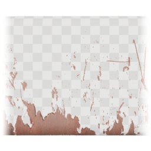
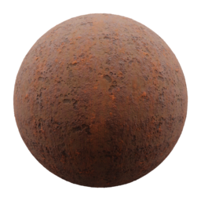
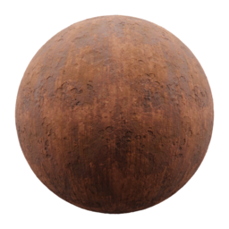
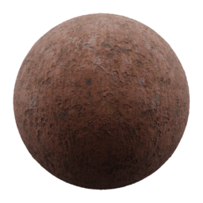
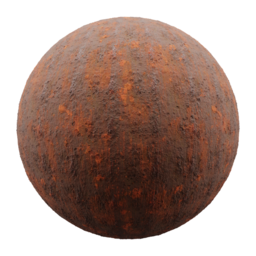
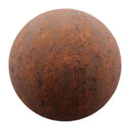
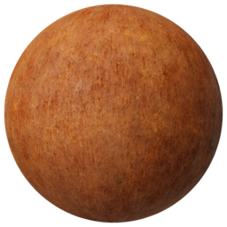
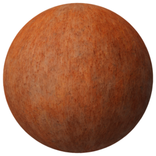
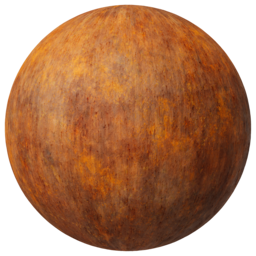
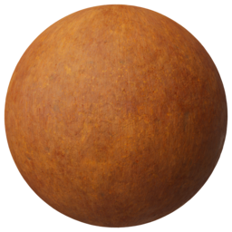

# ambientCG: Rust materials

**10 assets from [ambientCG](https://ambientcg.com), dedicated to the public domain under [CC0](https://docs.ambientcg.com/license/).** Use them in any game, free or paid, and change them however you like; no credit is needed.

PBR materials as 1K and 2K JPG maps (colour, normal GL and DX, roughness, AO, displacement), one folder per resolution. 331.1 MB in all.

This is a copy kept by [zuujis-cc0](https://github.com/zuujis-cc0) so game makers can take single files from GitHub. It is not made by or affiliated with ambientCG: the originals, often in more formats and higher resolutions, are on [ambientcg.com](https://ambientcg.com). If they help you, consider [supporting ambientCG](https://www.patreon.com/ambientCG).

Every file is listed in [MANIFEST.tsv](MANIFEST.tsv) with its size and SHA-256. More free assets: [the Zuujis collection](https://github.com/zuujis-cc0/free-game-assets#readme).

| | | | |
| :-: | :-: | :-: | :-: |
|  <b><a href="Rust001">Rust 001</a></b> by ambientCG · <a href="https://ambientcg.com/a/Rust001">source</a> |  <b><a href="Rust002">Rust 002</a></b> by ambientCG · <a href="https://ambientcg.com/a/Rust002">source</a> |  <b><a href="Rust003">Rust 003</a></b> by ambientCG · <a href="https://ambientcg.com/a/Rust003">source</a> |  <b><a href="Rust004">Rust 004</a></b> by ambientCG · <a href="https://ambientcg.com/a/Rust004">source</a> |
|  <b><a href="Rust005">Rust 005</a></b> by ambientCG · <a href="https://ambientcg.com/a/Rust005">source</a> |  <b><a href="Rust006">Rust 006</a></b> by ambientCG · <a href="https://ambientcg.com/a/Rust006">source</a> |  <b><a href="Rust007">Rust 007</a></b> by ambientCG · <a href="https://ambientcg.com/a/Rust007">source</a> |  <b><a href="Rust008">Rust 008</a></b> by ambientCG · <a href="https://ambientcg.com/a/Rust008">source</a> |
|  <b><a href="Rust009">Rust 009</a></b> by ambientCG · <a href="https://ambientcg.com/a/Rust009">source</a> |  <b><a href="Rust010">Rust 010</a></b> by ambientCG · <a href="https://ambientcg.com/a/Rust010">source</a> |  |  |

---

Kept up to date by this repository's own [update workflow](.github/workflows/update.yml), with code and plan from [cc0-mirror](https://github.com/zuujis-cc0/cc0-mirror). Something wrong? [Open an issue there](https://github.com/zuujis-cc0/cc0-mirror/issues/new) or use the [private report form](https://games.zuujis.com/report).
